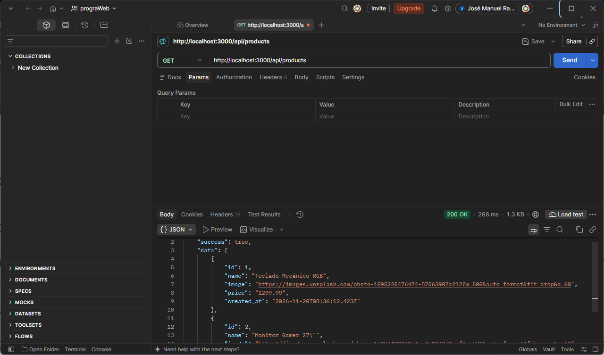
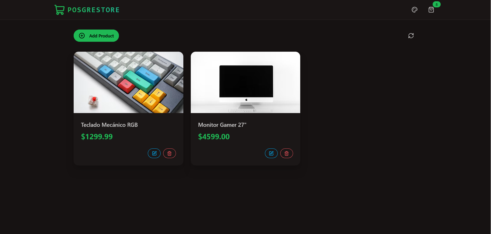
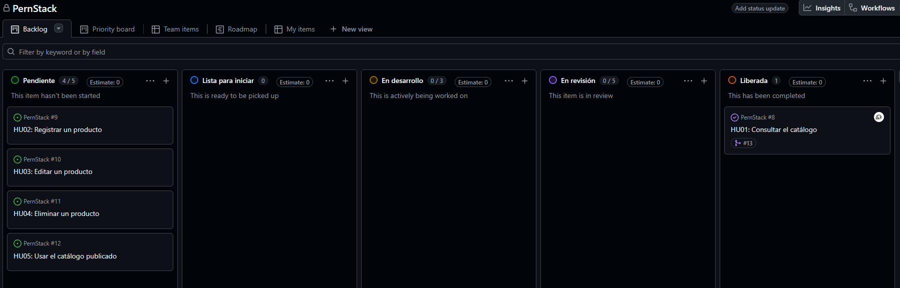
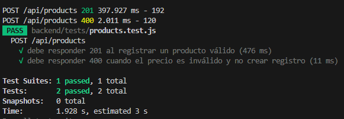
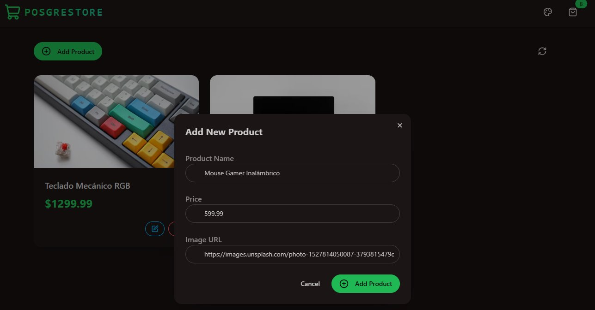
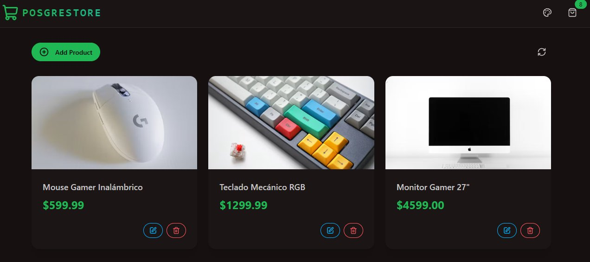
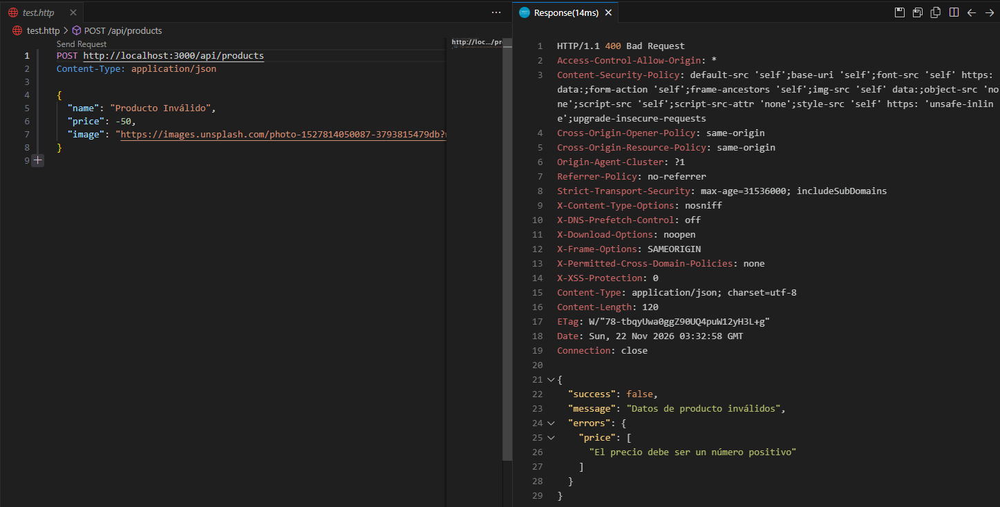

# Catalogo de productos PERN

Proyecto inicial para desarrollar un catalogo de productos con React, Express y PostgreSQL.

## Requisitos

- Node.js 18 o superior.
- npm, incluido con Node.js.

Comprueba las versiones instaladas:

```powershell
node --version
npm --version
```

## Instalacion

Clona el repositorio y entra en la carpeta del proyecto:

```powershell
git clone <URL_DEL_REPOSITORIO>
cd PernStack
```

Instala las dependencias del backend y del frontend:

```powershell
npm install

cd ../frontend
npm install
```

## Configuracion

El equipo comparte la configuracion de PostgreSQL/Neon.

## Ejecutar el frontend

Desde la carpeta raiz:

```powershell
npm run dev
```

Desde la carpeta `frontend`:

```powershell
npm run dev
```

Abre la direccion que muestre Vite en la terminal, normalmente:

```text
http://localhost:3000
```

## HU01: Consultar el catálogo

Como usuario del sistema,
quiero consultar el catálogo de productos,
para ver los productos disponibles y seleccionar uno para revisar sus detalles.

## Prueba del endpoint

### Caso 1: Consultar productos existentes

En Postman crea una solicitud con los siguientes datos:

| Campo  | Valor                                |
| ------ | ------------------------------------ |
| Método | `GET`                                |
| URL    | `http://localhost:3000/api/products` |
| Body   | No aplica                            |

Enviar la solicitud debe devolver el estado `200 OK`. La respuesta contiene un arreglo de productos dentro de `data`:

```json
{
  "success": true,
  "data": [
    {
      "id": 1,
      "name": "Teclado Mecánico RGB",
      "image": "https://images.unsplash.com/photo-1595225476474-87563907a212?w=500&auto=format&fit=crop&q=60",
      "price": "1299.99",
      "created_at": "2026-11-20T08:36:12.423Z"
    },
    {
      "id": 2,
      "name": "Monitor Gamer 27\"",
      "image": "https://images.unsplash.com/photo-1527443224154-c4a3942d3acf?w=500&auto=format&fit=crop&q=60",
      "price": "4599.00",
      "created_at": "2026-11-20T08:36:12.423Z"
    }
  ]
}
```

**Resultado esperado:** El frontend solicita el endpoint al cargar `HomePage` y muestra cada elemento recibido mediante `ProductCard`.

Captura de la respuesta en Postman:



Vista del catálogo en React:



### Caso 2: Consultar un catálogo vacío

Cuando no existen registros en la tabla `products`. Se repite la solicitud `GET` a `http://localhost:3000/api/products`.

La API debe devolver `200 OK` con un arreglo vacío:

```json
{
  "success": true,
  "data": []
}
```

**Resultado esperado:** No se genera un error HTTP. El frontend muestra un estado vacío indicando que no existen productos registrados.

Captura de la respuesta en Postman:


Vista vacía en React:


### Flujo principal

1. El usuario abre la aplicación en `http://localhost:5173`.
2. React renderiza `Navbar` y `HomePage`.
3. `HomePage` ejecuta `fetchProducts()` al cargar la página.
4. El store `useProductStore` envía una petición `GET` a `http://localhost:3000/api/products`.
5. Express recibe la petición en `/api/products`.
6. `productRoutes` dirige la petición al controlador `getAllProducts`.
7. `getAllProducts` consulta PostgreSQL y obtiene todos los productos ordenados por fecha de creación.
8. El backend responde con un JSON:

```json
{
  "success": true,
  "data": []
}
```

9. `useProductStore` guarda los productos recibidos en su estado.
10. `HomePage` muestra los productos mediante componentes `ProductCard`.

### Flujo alternativo

- Si la carga está en progreso, `HomePage` muestra el indicador de carga.
- Si el backend o la base de datos responde con un error, se muestra un mensaje de error en la interfaz.
- Si no existe ninguna respuesta exitosa, se mantiene una lista de productos vacía.
- Si el usuario actualiza la página, puede pulsar el botón de refrescar para repetir la consulta.

## Avance del tablero

Estado del tablero en GitHub Projects tras liberar **HU01** (`#8`, PR `#13`, etiqueta `u4-j1`):



## HU02: Registrar un producto

Como responsable del catálogo, quiero registrar un producto para que aparezca en la lista.

### Dependencias agregadas

- **Validación (DTO):** `zod`
- **Pruebas automatizadas:** `jest`, `supertest`, `cross-env` (`devDependencies`)
  - Aunque `cross-env` no aparece en la tabla base de la práctica, se incluye como apoyo en desarrollo para definir `NODE_ENV=test` en el script `npm test` de forma compatible entre Windows (PowerShell/CMD), macOS y Linux.

```powershell
npm install zod
npm install -D jest supertest cross-env
```

### Validación con DTO y Zod

- Se definió `createProductDto` en `backend/dtos/productDto.js` para validar:
  - `name`: cadena sin espacios y no vacía (`trim().min(1)`).
  - `price`: número positivo (`coerce.number().positive()`).
  - `image`: URL válida (`trim().url()`).

```javascript
export const createProductDto = z.object({
  name: z
    .string({ required_error: "El nombre es obligatorio" })
    .trim()
    .min(1, "El nombre no puede estar vacío"),
  price: z.coerce
    .number({ invalid_type_error: "El precio debe ser numérico" })
    .positive("El precio debe ser un número positivo"),
  image: z
    .string({ required_error: "La imagen es obligatoria" })
    .trim()
    .url("La imagen debe ser una URL válida"),
});
```

- El controlador `createProduct` en `backend/controllers/productController.js` valida `req.body` con `safeParse`:
  - Si la validación falla, responde **`400 Bad Request`** sin insertar en PostgreSQL.
  - Si es válida, inserta mediante consulta parametrizada en Neon y responde **`201 Created`**.

```javascript
const parsed = createProductDto.safeParse(req.body);

if (!parsed.success) {
  return res.status(400).json({
    success: false,
    message: "Datos de producto inválidos",
    errors: parsed.error.flatten().fieldErrors,
  });
}
```

### Pruebas automatizadas con Jest y Supertest

- **Jest** ejecuta la suite de pruebas y evalúa las aserciones (`describe`, `it`, `expect`).
- **Supertest** envía peticiones HTTP simuladas directamente contra la instancia `app` de Express en memoria, sin levantar el servidor en un puerto.

1. Se exportó `app` en `backend/server.js` y se condicionó `app.listen()` a `process.env.NODE_ENV !== 'test'`.
2. Se agregó el script `"test"` en `package.json`:

```json
"test": "cross-env NODE_ENV=test node --experimental-vm-modules node_modules/jest/bin/jest.js"
```

3. Se crearon las pruebas en `backend/tests/products.test.js` validando ambos casos con `expect(...).toMatchObject(...)` e incluyendo `afterAll` para eliminar el registro de prueba de Neon al finalizar:

```javascript
import request from "supertest";
import app from "../server.js";

describe("POST /api/products", () => {
  it("debe responder 201 al registrar un producto válido", async () => {
    const res = await request(app).post("/api/products").send({
      name: "Mouse Gamer Test",
      price: 599.99,
      image:
        "https://images.unsplash.com/photo-1527814050087-3793815479db?w=500",
    });

    expect({ status: res.statusCode, body: res.body }).toMatchObject({
      status: 201,
      body: {
        success: true,
        data: { id: expect.any(Number), name: "Mouse Gamer Test" },
      },
    });
  });

  it("debe responder 400 cuando el precio es inválido y no crear registro", async () => {
    const res = await request(app).post("/api/products").send({
      name: "Producto Inválido",
      price: -50,
      image:
        "https://images.unsplash.com/photo-1527814050087-3793815479db?w=500",
    });

    expect({ status: res.statusCode, body: res.body }).toMatchObject({
      status: 400,
      body: {
        success: false,
        errors: { price: expect.any(Array) },
      },
    });
  });
});
```

```powershell
npm test
```

Captura de las pruebas automatizadas con Jest y Supertest:



### Formulario y modal de alta en React

1. En `frontend/src/store/useProductStore.js` se agregó `formData`, `setFormData`, `resetForm` y `addProduct` para enviar la petición `POST /api/products`, recargar el catálogo y mostrar notificaciones con `react-hot-toast`:

```javascript
addProduct: async (e) => {
    e.preventDefault();
    set({ loading: true });

    try {
        const { formData } = get();
        await axios.post(`${BASE_URL}/api/products`, formData);
        await get().fetchProducts();
        get().resetForm();
        toast.success('Product added successfully');
        document.getElementById('add_product_modal')?.close();
    } catch (err) {
        const message = err.response?.data?.message || 'Something went wrong';
        toast.error(message);
    } finally {
        set({ loading: false });
    }
},
```

2. Se creó el componente `frontend/src/components/AddProductModal.jsx` con el diálogo modal de DaisyUI (`id="add_product_modal"`) y los campos `name`, `price` e `image`:

```jsx
<dialog id="add_product_modal" className="modal">
  <div className="modal-box">
    <h3 className="font-bold text-xl mb-8">Add New Product</h3>
    <form onSubmit={addProduct} className="space-y-6">
      {/* Inputs controlados con formData y setFormData */}
      <button type="submit" className="btn btn-primary" disabled={!formData.name || !formData.price || !formData.image || loading}>
        Add Product
      </button>
    </form>
  </div>
</dialog>
```

3. En `frontend/src/pages/HomePage.jsx` se conectó el botón **Add Product** a `showModal()` y se renderizó `<AddProductModal />`:

```jsx
<button
  className='btn btn-primary'
  onClick={() => document.getElementById('add_product_modal').showModal()}
>
  <PlusCircleIcon className='size-5 mr-2'/>
  Add Product
</button>
<AddProductModal />
```

4. En `frontend/src/App.jsx` se agregó `<Toaster />` para mostrar las alertas visuales de éxito o error:

```jsx
<Routes>
  <Route path="/" element={<HomePage />} />
  <Route path="/product/:id" element={<ProductPage />} />
</Routes>
<Toaster />
```


Captura del modal de alta con los datos del producto:



Captura del catálogo actualizado tras registrar el producto:




### Prueba de validación (`400 Bad Request`) con REST Client

Para probar el endpoint `POST /api/products` con un precio inválido sin crear registros en PostgreSQL, se utilizó la extensión **REST Client** (`humao.rest-client`) en VS Code enviando un precio negativo (`-50`):

```http
POST http://localhost:3000/api/products
Content-Type: application/json

{
  "name": "Producto Inválido",
  "price": -50,
  "image": "https://images.unsplash.com/photo-1527814050087-3793815479db?w=500"
}
```

Captura de la respuesta `400 Bad Request` devuelta por Zod:




## HU03: Editar un producto

Como responsable del catálogo, quiero cambiar los datos de un producto para mantener la información vigente.

**Criterios de aceptación**

- Una edición válida responde `200` y el cambio persiste al recargar.
- Un ID inexistente recibe `404`.
- Si falla la edición, la vista muestra el error y conserva el último dato confirmado en el catálogo.

### Backend

- `PUT /api/products/:id` valida el cuerpo con `updateProductDto` (los mismos campos que el alta) y responde:
  - `200` con el producto actualizado.
  - `400` si los datos son inválidos; no se modifica ningún registro.
  - `404` si el producto no existe.
- `GET /api/products/:id` ahora responde `404` cuando el producto no existe (antes devolvía `200` con `data` vacío). La pantalla de edición lo usa para cargar el producto.
- Un ID que no puede existir (`abc`, `-1`, `0`, `99999999999`) también responde `404` en lugar de `500`, porque se valida antes de consultar PostgreSQL.
- `backend/dtos/productDto.js` se ajustó a Zod 4 (los mensajes en español usan `error`) y agrega límites que coinciden con la tabla: nombre y URL de máximo 255 caracteres, precio máximo `99999999.99` con 2 decimales y URL con `http://` o `https://`.

### Frontend

- La ruta `/product/:id` (botón de editar de cada tarjeta) abre `ProductPage`, que muestra a la izquierda el **último dato guardado** y a la derecha el formulario de edición.
- `useProductStore` agrega `fetchProduct` y `updateProduct`. El catálogo (`products`) y `currentProduct` solo se actualizan cuando el backend confirma el cambio.
- Si el guardado falla (validación, ID inexistente o servidor caído), la vista muestra el mensaje de error, el dato guardado y el catálogo no cambian, y lo escrito queda en el formulario para corregirlo. El botón **Restore** vuelve al dato confirmado.
- Si el guardado es exitoso, se muestra una notificación y se regresa al catálogo, que ya trae el dato actualizado desde la base.

### Pruebas automatizadas

`backend/tests/products.update.test.js` cubre: edición `200` con persistencia al consultar de nuevo, `404` con ID inexistente y con IDs inválidos (sin `500`), `400` con precio inválido verificando que el dato anterior no cambia, y `404` en `GET /api/products/:id`.

```powershell
npm test
```

### Pruebas manuales (evidencia)

**Caso 1: edición válida desde React.** En el catálogo pulsa el botón de editar de un producto, cambia el nombre o el precio, pulsa **Save changes** y verifica que el catálogo muestra el cambio. Recarga la página (`F5`) y comprueba que persiste.

<!-- TODO: captura de la pantalla de edición y del catálogo actualizado tras recargar -->

**Caso 2: ID inexistente.** En Postman, `PUT http://localhost:3000/api/products/9999` con un cuerpo válido debe responder `404`. En React, abrir `http://localhost:5173/product/9999` muestra el mensaje "Producto no encontrado".

<!-- TODO: captura de Postman con el 404 y de la vista en React -->

**Caso 3: falla la edición.** Con la pantalla de edición abierta, provoca el error de una de estas formas:

1. Escribe un precio de `100000000` (supera el máximo) y guarda: la vista muestra "Datos de producto inválidos: El precio es demasiado alto".
2. Elimina el producto desde Postman (`DELETE /api/products/:id`) y guarda: la vista muestra "Producto no encontrado".
3. Detén el backend y guarda: la vista muestra "No se pudo conectar con el servidor".

En los tres casos, "Last saved data" y el catálogo conservan el último dato confirmado.

<!-- TODO: captura del error en pantalla con el dato guardado sin cambios -->
