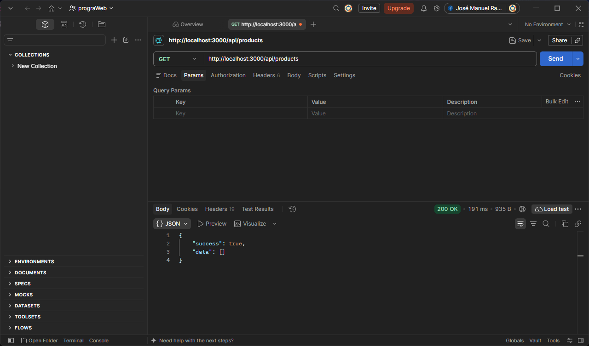
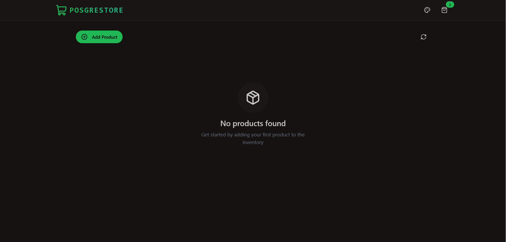

# Catalogo de productos PERN

Proyecto inicial para desarrollar un catalogo de productos con React, Express y PostgreSQL.

## Requisitos

- Node.js 18 o superior.
- npm, incluido con Node.js.

Comprueba las versiones instaladas:

```powershell
node --version
npm --version
```

## Instalacion

Clona el repositorio y entra en la carpeta del proyecto:

```powershell
git clone <URL_DEL_REPOSITORIO>
cd PernStack
```

Instala las dependencias del backend y del frontend:

```powershell
npm install

cd ../frontend
npm install
```

## Configuracion

El equipo comparte la configuracion de PostgreSQL/Neon. 

## Ejecutar el frontend

Desde la carpeta raiz:

```powershell
npm run dev
```

Desde la carpeta `frontend`:

```powershell
npm run dev
```

Abre la direccion que muestre Vite en la terminal, normalmente:

```text
http://localhost:3000
```

## HU01: Consultar el catálogo

Como usuario del sistema,
quiero consultar el catálogo de productos,
para ver los productos disponibles y seleccionar uno para revisar sus detalles.

## Prueba del endpoint

### Caso 1: Consultar productos existentes

En Postman crea una solicitud con los siguientes datos:

| Campo | Valor |
| --- | --- |
| Método | `GET` |
| URL | `http://localhost:3000/api/products` |
| Body | No aplica |

Enviar la solicitud debe devolver el estado `200 OK`. La respuesta contiene un arreglo de productos dentro de `data`:

```json
{
    "success": true,
    "data": [
        {
            "id": 1,
            "name": "Teclado Mecánico RGB",
            "image": "https://images.unsplash.com/photo-1595225476474-87563907a212?w=500&auto=format&fit=crop&q=60",
            "price": "1299.99",
            "created_at": "2026-11-20T08:36:12.423Z"
        },
        {
            "id": 2,
            "name": "Monitor Gamer 27\"",
            "image": "https://images.unsplash.com/photo-1527443224154-c4a3942d3acf?w=500&auto=format&fit=crop&q=60",
            "price": "4599.00",
            "created_at": "2026-11-20T08:36:12.423Z"
        }
    ]
}
```

**Resultado esperado:** El frontend solicita el endpoint al cargar `HomePage` y muestra cada elemento recibido mediante `ProductCard`.

Captura de la respuesta en Postman:


Vista del catálogo en React:


### Caso 2: Consultar un catálogo vacío

Cuando no existen registros en la tabla `products`. Se repite la solicitud `GET` a `http://localhost:3000/api/products`.

La API debe devolver `200 OK` con un arreglo vacío:

```json
{
  "success": true,
  "data": []
}
```

**Resultado esperado:** No se genera un error HTTP. El frontend muestra un estado vacío indicando que no existen productos registrados.

Captura de la respuesta en Postman:



Vista vacía en React:




### Flujo principal

1. El usuario abre la aplicación en `http://localhost:5173`.
2. React renderiza `Navbar` y `HomePage`.
3. `HomePage` ejecuta `fetchProducts()` al cargar la página.
4. El store `useProductStore` envía una petición `GET` a `http://localhost:3000/api/products`.
5. Express recibe la petición en `/api/products`.
6. `productRoutes` dirige la petición al controlador `getAllProducts`.
7. `getAllProducts` consulta PostgreSQL y obtiene todos los productos ordenados por fecha de creación.
8. El backend responde con un JSON:

```json
{
  "success": true,
  "data": []
}
```

9. `useProductStore` guarda los productos recibidos en su estado.
10. `HomePage` muestra los productos mediante componentes `ProductCard`.

### Flujo alternativo

- Si la carga está en progreso, `HomePage` muestra el indicador de carga.
- Si el backend o la base de datos responde con un error, se muestra un mensaje de error en la interfaz.
- Si no existe ninguna respuesta exitosa, se mantiene una lista de productos vacía.
- Si el usuario actualiza la página, puede pulsar el botón de refrescar para repetir la consulta.